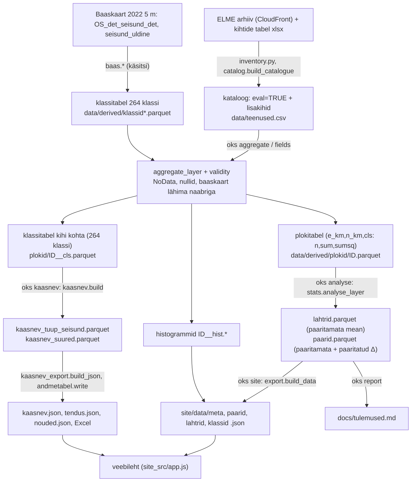

# Keskmiste arvutuse dokumentatsioon ja valideerimine

> **Metoodika v1.** See dokument kirjeldab ja valideerib metoodika v1 keskmiste arvutust (NoData välja, aritmeetiline
> keskmine). Metoodika v2 (täpsed pikslimediaanid, NoData = 0 v.a erandkihid) on kirjeldatud failides
> [metoodika.md](metoodika.md) ja [metoodika_v2_otsused.md](metoodika_v2_otsused.md); v2 mediaanide sõltumatu kontroll on
> `scripts/valideeri_keskmised.py` V8. Keskmisepõhine arvutus on v2-s alles ja selle kontrollid V1–V7 kehtivad.

**Repo:** https://github.com/TPiparKAUR/kaasavakasu · **Haru:** `claude/compassionate-babbage-mdfftn`
**Analüüsitud kood (SHA):** `542ce57bc2cb41f93f5409215e71b4e71681ed8a` (kõik koodiviited alljärgnevas on selle SHA püsilingid)
**Skriptid (SHA):** `721acb837149c7dd5ac6f5562e5f03382bc88e47` (võrreldes 542ce57-ga lisab ainult `scripts/valideeri_*.py`, `scripts/naide_paaritatud.py`, `data/tulemused/validatsioon_*.json`, `README.md` testide arvu; `src/` ja `site_src/` on identsed SHA-ga 542ce57). See dokument (`docs/keskmiste_arvutus.md`) lisatakse järgmises commitis.
**Koostatud:** 2026-10-20T08:40Z (UTC) = 2026-10-20 11:40 EEST · **Veebileht:** https://tpiparkaur.github.io/kaasavakasu/
**Testid:** `uv sync` ja `uv run pytest -q` → **59 passed** (49 s) SHA-l 542ce57; `ruff check`, `ruff format --check`, `mypy src` rohelised.

Märgistus: **[K]** = koodis loetud fakt (viitega), **[M]** = väide failis `docs/metoodika.md`, **[J]** = minu järeldus. Kus midagi ei leidnud, on kirjas „ei leitud“.

## 1. Kokkuvõte

* **Kaks eri „keskmist“.** *Paaritamata* keskmine on teenuse pikslite aritmeetiline keskmine ühes (ühik × seisund) rühmas: Σx / Σn kõigil kehtivatel pikslitel [K [stats.py:192-422](https://github.com/TPiparKAUR/kaasavakasu/blob/542ce57bc2cb41f93f5409215e71b4e71681ed8a/src/oks/stats.py#L192-L422), rida 240]. *Paaritatud* ei ole keskmine, vaid **seisundite erinevuse (Δ) hinnang**: erinevus arvutatakse iga stratumi (1 km plokk × alamökosüsteem) sees ja stratumid keskmistatakse kaaluga w = n_a·n_b/(n_a+n_b) [K stats.py:298, 313]. Paaritatud hinnang ei anna „paaritatud keskmist taset“; selle `mean_a` on paaritamata keskmine ja ainult `rel_m` nimetaja on stratumite kaaluga keskmistatud halvema seisundi keskmine [K stats.py:348, 372].
* **Tulemustabel, stsenaarium, avaleht, Excel näitavad paaritamata keskmisi** (klassitabelist, nullid kaasa arvatud). **Paaritatud Δ** on lehel „Statistiline analüüs“ (vaikimisi valitud, `S.est = 'm'`), stsenaariumi „kontroll“-veerus ja kvalitatiivse vahekaardi tõendusbaasis.
* **Sõltumatu ümberarvutus** (Polars, ei kasuta `oks.stats` ega `oks.kaasnev`): 3 772 (ühik × seisund) paaritamata keskmist ja `n` ühtivad `lahtrid.parquet`-iga (max suhteline viga 1,7·10⁻¹⁴, n lahknevusi 0); 3 294 paaritatud Δ ja `n_strata` ühtivad `paarid.parquet`-iga (max abs. viga 1,2·10⁻¹⁰); 4 513 tüüp × seisund keskmist klassitabelist ühtivad kaasneva kasu tabeliga täpselt; ökosüsteemi keskmine plokitabelist ja klassitabelist erineb ≤ 2,3·10⁻¹⁵; veebilehe kuvatud 2 746 arvu (Tulemustabel), 10 stsenaariumirida ja 3 599 Exceli lahtrit ühtivad tulemusfailidega (0 lahknevust). Baaskaardi pikslite arv ja seisundikaardistus kontrolliti rastrist (264 koodi, 0 lahknevust).
* **Leitud lahknevused** (täpsemalt § 6.3): (1) `docs/metoodika.md` väidab, et klassid, kus nullist erinevaid piksleid on alla 1 %, jäetakse seisundi muutuse analüüsist välja; **koodis seda filtrit analüüsis ei ole** (kasutusel ainult tulemustabeli märgendis) – 273 `paarid` rida (7 kihti) võrdleb nulli nulliga, neist 231 on `enough_m = true`. (2) Raha- ja biofüüsikalise kihi keskmised ei ole omavahel järjekindlad, kui kihtide kate erineb (nt seente EUR/ha ÷ kg/ha = 3,2…4,5, oodatud 4,5). (3) Klassitabelite (`data/derived/klassid*.parquet`, `baaskaart_ristiks_5m.parquet`) tekitamise sammu ei ole ühegi CLI käsu taga (**ei leitud**).
* **Paaritatud ja paaritamata erinevus on suur**: ökosüsteemi tasandil (vilets → hea) erineb märk 13 võrdluses 109-st, mediaan |Δ_m − Δ_u| / |Δ_u| = 0,86. Näide (seened, metsad): Δ_u = +20,20 kg/ha, Δ_m = +18,20 kg/ha; paaritatud hinnang kasutab ainult 17 % viletsa ja 44 % hea seisundi piksleid.

## 2. Üldstruktuur



| CLI käsk | Funktsioon | Sisend → väljund |
|---|---|---|
| `aggregate` | [pipeline.py:123-170](https://github.com/TPiparKAUR/kaasavakasu/blob/542ce57bc2cb41f93f5409215e71b4e71681ed8a/src/oks/pipeline.py#L123-L170) | arhiivi rastrid → `plokid/<id>.parquet`, `__hist.*`, `__cls.parquet` [K `__main__.py:29-30`] |
| `fields` | [pipeline.py:192-221](https://github.com/TPiparKAUR/kaasavakasu/blob/542ce57bc2cb41f93f5409215e71b4e71681ed8a/src/oks/pipeline.py#L192-L221) | põllumassiivi gpkg → 10 m raster → samad failid [K `__main__.py:43-44`] |
| `analyse` | [analysis.py:289-374](https://github.com/TPiparKAUR/kaasavakasu/blob/542ce57bc2cb41f93f5409215e71b4e71681ed8a/src/oks/analysis.py#L289-L374) | plokitabelid → `lahtrid`, `paarid`, `klassid`, `jaotused`, `diagnostika`, `uhikud` .parquet [K analysis.py:372] |
| `kaasnev` | [kaasnev.py:223-239](https://github.com/TPiparKAUR/kaasavakasu/blob/542ce57bc2cb41f93f5409215e71b4e71681ed8a/src/oks/kaasnev.py#L223-L239) | klassitabelid → `kaasnev_tuup_seisund.parquet`, `kaasnev_suured.parquet` [K `__main__.py:35-36`] |
| `report` | [report.py:106-358](https://github.com/TPiparKAUR/kaasavakasu/blob/542ce57bc2cb41f93f5409215e71b4e71681ed8a/src/oks/report.py#L106-L358) | tulemused → `docs/tulemused.md`, `docs/andmekataloog.md`, `docs/lahteulesanne.md` [K `__main__.py:37-40`] |
| `site` | [sitebuild.py:26-67](https://github.com/TPiparKAUR/kaasavakasu/blob/542ce57bc2cb41f93f5409215e71b4e71681ed8a/src/oks/sitebuild.py#L26-L67) | tulemused → `site/` (JSON, Excel, ühefailne HTML) [K sitebuild.py:46-50] |

**[J] Sõltuvused:** `kaasnev` ei sõltu `analyse`-st (loeb ainult klassitabeleid), kuid `site` vajab mõlemat (`paarid`/`lahtrid` ja `kaasnev_*.parquet`); ilma `kaasnev_*.parquet`-ita jäetakse kaasneva kasu osa lihtsalt ehitamata [K sitebuild.py:47-50]. Segumudeli (930 m, `lamm_grd1000…`) kihid lähevad `analyse` sees läbi `run_mixing` [K analysis.py:142].

## 3. A. Paaritamata keskmised

### 3.1 Andmevoog

1. **Algandmed [K].** Arhiivi baas `https://d549q4t3lqrx1.cloudfront.net/arhiiv/` ([config.py:8-9](https://github.com/TPiparKAUR/kaasavakasu/blob/542ce57bc2cb41f93f5409215e71b4e71681ed8a/src/oks/config.py#L8-L9)); ametlik kihtide tabel `alusmaterjalid/metaandmed/layer_definition_checked_vrs2.csv` ([catalog.py:154-248](https://github.com/TPiparKAUR/kaasavakasu/blob/542ce57bc2cb41f93f5409215e71b4e71681ed8a/src/oks/catalog.py#L154-L248)); baaskaart `OS_det_seisund_det_2022_5m.tif` ([config.py:24](https://github.com/TPiparKAUR/kaasavakasu/blob/542ce57bc2cb41f93f5409215e71b4e71681ed8a/src/oks/config.py#L24-L24)).
2. **Kihtide valik [K].** `eval = TRUE` ja grupp ≠ baaskaart, **lisaks** neli lähtekasu lisakihti `BRIEF_EXTRA` ([catalog.py:251-255](https://github.com/TPiparKAUR/kaasavakasu/blob/542ce57bc2cb41f93f5409215e71b4e71681ed8a/src/oks/catalog.py#L251-L255), [catalog.py:103-126](https://github.com/TPiparKAUR/kaasavakasu/blob/542ce57bc2cb41f93f5409215e71b4e71681ed8a/src/oks/catalog.py#L103-L126)). Plokitabeli teekonda läbivad ainult rasterid, mille eraldusvõime ≤ 10 m (`MAX_RES_M = 10`, [pipeline.py:21](https://github.com/TPiparKAUR/kaasavakasu/blob/542ce57bc2cb41f93f5409215e71b4e71681ed8a/src/oks/pipeline.py#L21-L21), [pipeline.py:130-131](https://github.com/TPiparKAUR/kaasavakasu/blob/542ce57bc2cb41f93f5409215e71b4e71681ed8a/src/oks/pipeline.py#L130-L131)); 930 m rastrid ja 1 km vektor lähevad segumudelisse (uuriv).
3. **Seisundi määramine [K].** `seisund_uldine` 1/2/3 → hea/keskmine/vilets ([baas.py:173](https://github.com/TPiparKAUR/kaasavakasu/blob/542ce57bc2cb41f93f5409215e71b4e71681ed8a/src/oks/baas.py#L173-L173)); iga detailne kood peab kaardistuma täpselt ühele seisundile, vastasel juhul `ValueError` ([baas.py:146-182](https://github.com/TPiparKAUR/kaasavakasu/blob/542ce57bc2cb41f93f5409215e71b4e71681ed8a/src/oks/baas.py#L146-L182)); indeks analüüsis `cls_state = 3 − uld` (0 vilets, 1 keskmine, 2 hea; [stats.py:100](https://github.com/TPiparKAUR/kaasavakasu/blob/542ce57bc2cb41f93f5409215e71b4e71681ed8a/src/oks/stats.py#L100-L100)). **[M]** metoodika.md:27-54 kirjeldab vastavust A–F → hea/keskmine/vilets (kinnitatud lähtekasu taustatabeliga).
4. **Pikslite filtreerimine [K].** [aggregate.py:44-79](https://github.com/TPiparKAUR/kaasavakasu/blob/542ce57bc2cb41f93f5409215e71b4e71681ed8a/src/oks/aggregate.py#L44-L79): kehtiv = ei ole deklareeritud NoData (GDAL mask), ei ole NaN/∞, ei ole `invalid` sentinel; `zero_values` (deklareeritud NoData = 0 ja `ohusaaste` 255) loetakse **kehtivaks nulliks** ([catalog.py:258-277](https://github.com/TPiparKAUR/kaasavakasu/blob/542ce57bc2cb41f93f5409215e71b4e71681ed8a/src/oks/catalog.py#L258-L277), [aggregate.py:74-76](https://github.com/TPiparKAUR/kaasavakasu/blob/542ce57bc2cb41f93f5409215e71b4e71681ed8a/src/oks/aggregate.py#L74-L76)). Piksel peab kuuluma klassi, millel on seisund ([aggregate.py:199-200](https://github.com/TPiparKAUR/kaasavakasu/blob/542ce57bc2cb41f93f5409215e71b4e71681ed8a/src/oks/aggregate.py#L199-L200)). Minimaalset n ei rakendata mitte keskmise arvutamisel, vaid hinnangu „piisavuse“ lipul (§ 3.2).
5. **Rasterdamine ja ruudustik [K].** Baaskaart (5 m) taasproovitakse teenuse ruudustikule lähima naabriga ([aggregate.py:93-110](https://github.com/TPiparKAUR/kaasavakasu/blob/542ce57bc2cb41f93f5409215e71b4e71681ed8a/src/oks/aggregate.py#L93-L110)); põllumassiivid rasteriseeritakse 10 m ([fields.py:34-110](https://github.com/TPiparKAUR/kaasavakasu/blob/542ce57bc2cb41f93f5409215e71b4e71681ed8a/src/oks/fields.py#L34-L110)). Piksel liigitatakse 1 km plokki piksli **keskpunkti** järgi ([aggregate.py:186-189](https://github.com/TPiparKAUR/kaasavakasu/blob/542ce57bc2cb41f93f5409215e71b4e71681ed8a/src/oks/aggregate.py#L186-L189), [aggregate.py:82-90](https://github.com/TPiparKAUR/kaasavakasu/blob/542ce57bc2cb41f93f5409215e71b4e71681ed8a/src/oks/aggregate.py#L82-L90)).
6. **Agregeerimine [K].** Võti `(e_km, n_km, cls)`, väärtused `n` (pikslid), `sum` (Σx), `sumsq` (Σx²) ([aggregate.py:140-243](https://github.com/TPiparKAUR/kaasavakasu/blob/542ce57bc2cb41f93f5409215e71b4e71681ed8a/src/oks/aggregate.py#L140-L243), [aggregate.py:204-216](https://github.com/TPiparKAUR/kaasavakasu/blob/542ce57bc2cb41f93f5409215e71b4e71681ed8a/src/oks/aggregate.py#L204-L216)); salvestus `data/derived/plokid/<id>.parquet` ([pipeline.py:108](https://github.com/TPiparKAUR/kaasavakasu/blob/542ce57bc2cb41f93f5409215e71b4e71681ed8a/src/oks/pipeline.py#L108-L108)). `n` hoitakse analüüsis `Int64`-ina (Int32 ületäitub).
7. **Keskmise arvutus [K].** `mean = Σsum / Σn` üle (klaster, ühik, seisund) summade ([stats.py:239-240](https://github.com/TPiparKAUR/kaasavakasu/blob/542ce57bc2cb41f93f5409215e71b4e71681ed8a/src/oks/stats.py#L239-L240)). Kaalu ei ole: summeeritakse pikslid, st **pikslite arvuga (= pindalaga teenuse eraldusvõimel) kaalutud** keskmine. SD: `√((Σx² − (Σx)²/n)/(n−1))` ([stats.py:241-243](https://github.com/TPiparKAUR/kaasavakasu/blob/542ce57bc2cb41f93f5409215e71b4e71681ed8a/src/oks/stats.py#L241-L243)). Ümardamist parquet-failides ei ole.
8. **Ühikud ja ökosüsteemi/alamökosüsteemi tase [K].** Ökosüsteemi tase: kõik 228 seisundiklassi (`eco ≥ 0`, [stats.py:224](https://github.com/TPiparKAUR/kaasavakasu/blob/542ce57bc2cb41f93f5409215e71b4e71681ed8a/src/oks/stats.py#L224-L224)); alamökosüsteemi tase: ainult tüübid, millel on baaskaardil ≥ 2 seisundit (39 tüüpi 62-st; [stats.py:89](https://github.com/TPiparKAUR/kaasavakasu/blob/542ce57bc2cb41f93f5409215e71b4e71681ed8a/src/oks/stats.py#L89-L89)). Pindala ühikule: `unit_table` ([analysis.py:26-60](https://github.com/TPiparKAUR/kaasavakasu/blob/542ce57bc2cb41f93f5409215e71b4e71681ed8a/src/oks/analysis.py#L26-L60)), baaskaardi 5 m piksel = 25 m².
9. **Salvestus [K].** `data/tulemused/lahtrid.parquet` (veerud `unit_level, unit_code, state, n, mean, sd, blocks, q05…q95`; [stats.py:393-407](https://github.com/TPiparKAUR/kaasavakasu/blob/542ce57bc2cb41f93f5409215e71b4e71681ed8a/src/oks/stats.py#L393-L407)) ja `paarid.parquet` (`mean_a`, `mean_b` on samad keskmised; [stats.py:349-381](https://github.com/TPiparKAUR/kaasavakasu/blob/542ce57bc2cb41f93f5409215e71b4e71681ed8a/src/oks/stats.py#L349-L381)).
10. **Teine, sõltumatu tee (klassitabel) [K].** Samal läbikäigul kogutakse kõigi 264 klassi kohta `n_total, n_valid, n_zero, n_pos, n_neg, sum, sumsq` ([aggregate.py:113-137](https://github.com/TPiparKAUR/kaasavakasu/blob/542ce57bc2cb41f93f5409215e71b4e71681ed8a/src/oks/aggregate.py#L113-L137), [pipeline.py:36-43](https://github.com/TPiparKAUR/kaasavakasu/blob/542ce57bc2cb41f93f5409215e71b4e71681ed8a/src/oks/pipeline.py#L36-L43)). `kaasnev.summarise` arvutab `mean = Σsum / Σn_valid` (sh seisundita klassid, rannik) ([kaasnev.py:106-151](https://github.com/TPiparKAUR/kaasavakasu/blob/542ce57bc2cb41f93f5409215e71b4e71681ed8a/src/oks/kaasnev.py#L106-L151), [kaasnev.py:136](https://github.com/TPiparKAUR/kaasavakasu/blob/542ce57bc2cb41f93f5409215e71b4e71681ed8a/src/oks/kaasnev.py#L136-L136)); pindala (ha) = baaskaardi `n_pix × 25 / 10 000` ([kaasnev.py:76](https://github.com/TPiparKAUR/kaasavakasu/blob/542ce57bc2cb41f93f5409215e71b4e71681ed8a/src/oks/kaasnev.py#L76-L76)); suure ökosüsteemi väärtus = **pikslite järgi kaalutud** Σsum/Σn_valid üle klasside ([kaasnev.py:165-215](https://github.com/TPiparKAUR/kaasavakasu/blob/542ce57bc2cb41f93f5409215e71b4e71681ed8a/src/oks/kaasnev.py#L165-L215)). Kuivad/märjad metsad: `alam_kood` loend ([kaasnev.py:48-57](https://github.com/TPiparKAUR/kaasavakasu/blob/542ce57bc2cb41f93f5409215e71b4e71681ed8a/src/oks/kaasnev.py#L48-L57)).
11. **Eksport ja kuvamine [K].** `export._r` ümardab JSON-is 5 olulise numbrini ([export.py:19-31](https://github.com/TPiparKAUR/kaasavakasu/blob/542ce57bc2cb41f93f5409215e71b4e71681ed8a/src/oks/export.py#L19-L31), [export.py:16](https://github.com/TPiparKAUR/kaasavakasu/blob/542ce57bc2cb41f93f5409215e71b4e71681ed8a/src/oks/export.py#L16-L16)), täpsed väärtused jäävad parquet/CSV/Excelisse; leht vormindab `fmt()` ([app.js:18-30](https://github.com/TPiparKAUR/kaasavakasu/blob/542ce57bc2cb41f93f5409215e71b4e71681ed8a/site_src/app.js#L18-L30): ≥ 1000 → 0 komakohta, ≥ 10 → 1, ≥ 1 → 2, ≥ 0,01 → 3, väiksemad 2 olulist numbrit).

### 3.2 Sammude tabel

| Samm | Eesmärk | Funktsioon / moodul | Püsilink | Sisend → väljund | Eeldused |
|---|---|---|---|---|---|
| Kataloog | valida analüüsitavad kihid | `catalog.build_catalogue`, `evaluated` | [catalog.py:154-248](https://github.com/TPiparKAUR/kaasavakasu/blob/542ce57bc2cb41f93f5409215e71b4e71681ed8a/src/oks/catalog.py#L154-L248); [catalog.py:251-255](https://github.com/TPiparKAUR/kaasavakasu/blob/542ce57bc2cb41f93f5409215e71b4e71681ed8a/src/oks/catalog.py#L251-L255) | `layer_definition_checked_vrs2.csv` + `data/arhiiv_failid.csv` → `data/teenused.csv` (`id, fail, tyyp, eval, nodata, uhik, omadus`) | `eval = TRUE`; ühikud käsitsi `UNITS` ([catalog.py:19-87](https://github.com/TPiparKAUR/kaasavakasu/blob/542ce57bc2cb41f93f5409215e71b4e71681ed8a/src/oks/catalog.py#L19-L87)), tabel ühikut ei anna |
| Klassid | detailkood → tüüp, seisund | `baas.state_table`, `class_lut`, `class_lut_all` | [baas.py:146-182](https://github.com/TPiparKAUR/kaasavakasu/blob/542ce57bc2cb41f93f5409215e71b4e71681ed8a/src/oks/baas.py#L146-L182); [baas.py:185-197](https://github.com/TPiparKAUR/kaasavakasu/blob/542ce57bc2cb41f93f5409215e71b4e71681ed8a/src/oks/baas.py#L185-L197); [baas.py:200-211](https://github.com/TPiparKAUR/kaasavakasu/blob/542ce57bc2cb41f93f5409215e71b4e71681ed8a/src/oks/baas.py#L200-L211) | RAT + ristiks → `klassid.parquet` (`kood, tuup, alam_kood, uld, seisund, n_pix`) | iga kood ühel seisundil; **tekitamise käsk ei leitud** (§ 6.3) |
| Kehtivus | NoData, nullid | `aggregate.validity` | [aggregate.py:44-79](https://github.com/TPiparKAUR/kaasavakasu/blob/542ce57bc2cb41f93f5409215e71b4e71681ed8a/src/oks/aggregate.py#L44-L79) | rasteri väärtus + mask → `ok`, väärtus | `catalog.ZERO_EXTRA`, `zero_values` ([catalog.py:258-277](https://github.com/TPiparKAUR/kaasavakasu/blob/542ce57bc2cb41f93f5409215e71b4e71681ed8a/src/oks/catalog.py#L258-L277)) |
| Ruudustik | seisund teenuse pikslile | `_baas_chunk`, `_row_runs` | [aggregate.py:93-110](https://github.com/TPiparKAUR/kaasavakasu/blob/542ce57bc2cb41f93f5409215e71b4e71681ed8a/src/oks/aggregate.py#L93-L110); [aggregate.py:82-90](https://github.com/TPiparKAUR/kaasavakasu/blob/542ce57bc2cb41f93f5409215e71b4e71681ed8a/src/oks/aggregate.py#L82-L90) | baaskaart 5 m → teenuse ruudustik | lähim naaber; plokk piksli keskpunktist |
| Plokisummad | n, Σx, Σx² | `aggregate.aggregate_layer` | [aggregate.py:140-243](https://github.com/TPiparKAUR/kaasavakasu/blob/542ce57bc2cb41f93f5409215e71b4e71681ed8a/src/oks/aggregate.py#L140-L243) | rasterid → `plokid/<id>.parquet` (`e_km,n_km,cls,n,sum,sumsq`) | mälupiirang: ribade kaupa |
| Klassisummad | 264 klassi, katvus | `_accumulate_classes`, `write_cls` | [aggregate.py:113-137](https://github.com/TPiparKAUR/kaasavakasu/blob/542ce57bc2cb41f93f5409215e71b4e71681ed8a/src/oks/aggregate.py#L113-L137); [pipeline.py:36-43](https://github.com/TPiparKAUR/kaasavakasu/blob/542ce57bc2cb41f93f5409215e71b4e71681ed8a/src/oks/pipeline.py#L36-L43) | sama läbikäik → `plokid/<id>__cls.parquet` | `n_total` = baaskaardi klassi pikslid teenuse ruudustikul |
| Ühikud | ökosüsteem/alam | `stats.make_units` | [stats.py:81-104](https://github.com/TPiparKAUR/kaasavakasu/blob/542ce57bc2cb41f93f5409215e71b4e71681ed8a/src/oks/stats.py#L81-L104) | `klassid_kasutusel.parquet` → `Units` | alam ainult ≥ 2 seisundiga |
| Paaritamata keskmine | Σsum/Σn | `stats.analyse_layer` | [stats.py:223-243](https://github.com/TPiparKAUR/kaasavakasu/blob/542ce57bc2cb41f93f5409215e71b4e71681ed8a/src/oks/stats.py#L223-L243) | plokitabel → `tot_n, tot_s, mean, sd` | piksli kaal = 1 |
| Piisavus (paaritamata) | usaldusväärne Δ_u | `analyse_layer` | [stats.py:345-347](https://github.com/TPiparKAUR/kaasavakasu/blob/542ce57bc2cb41f93f5409215e71b4e71681ed8a/src/oks/stats.py#L345-L347) | → `enough_u` | ≥ 20 plokki (n ≥ `n_min`) kummaski seisundis ja ≥ 5 klastrit ([stats.py:44-54](https://github.com/TPiparKAUR/kaasavakasu/blob/542ce57bc2cb41f93f5409215e71b4e71681ed8a/src/oks/stats.py#L44-L54)) |
| Salvestus | tulemusfailid | `analysis.run` | [analysis.py:289-374](https://github.com/TPiparKAUR/kaasavakasu/blob/542ce57bc2cb41f93f5409215e71b4e71681ed8a/src/oks/analysis.py#L289-L374) | → `lahtrid/paarid/klassid.parquet` | FDR eraldi ökosüsteemi ja alamökosüsteemi tasemel ([analysis.py:377-399](https://github.com/TPiparKAUR/kaasavakasu/blob/542ce57bc2cb41f93f5409215e71b4e71681ed8a/src/oks/analysis.py#L377-L399)) |
| Tulemustabeli keskmine | keskmine tüübi × seisundi kohta | `kaasnev.type_state` | [kaasnev.py:106-151](https://github.com/TPiparKAUR/kaasavakasu/blob/542ce57bc2cb41f93f5409215e71b4e71681ed8a/src/oks/kaasnev.py#L106-L151); [kaasnev.py:154-162](https://github.com/TPiparKAUR/kaasavakasu/blob/542ce57bc2cb41f93f5409215e71b4e71681ed8a/src/oks/kaasnev.py#L154-L162) | `__cls.parquet` → `kaasnev_tuup_seisund.parquet` (`mean, sd, kate, esineb_osa, staatus, pindala_ha`) | staatuse lävendid ([kaasnev.py:29-31](https://github.com/TPiparKAUR/kaasavakasu/blob/542ce57bc2cb41f93f5409215e71b4e71681ed8a/src/oks/kaasnev.py#L29-L31), [catalog.py:133](https://github.com/TPiparKAUR/kaasavakasu/blob/542ce57bc2cb41f93f5409215e71b4e71681ed8a/src/oks/catalog.py#L133-L133)) |
| Suured ökosüsteemid | kaalutud keskmine | `kaasnev.big_classes` | [kaasnev.py:165-215](https://github.com/TPiparKAUR/kaasavakasu/blob/542ce57bc2cb41f93f5409215e71b4e71681ed8a/src/oks/kaasnev.py#L165-L215) | → `kaasnev_suured.parquet` | „Asustus ja muu“ ei liideta |
| Veebi andmed | JSON | `export.build_data`, `kaasnev_export.build_json` | [export.py:38-236](https://github.com/TPiparKAUR/kaasavakasu/blob/542ce57bc2cb41f93f5409215e71b4e71681ed8a/src/oks/export.py#L38-L236); [kaasnev_export.py:119-230](https://github.com/TPiparKAUR/kaasavakasu/blob/542ce57bc2cb41f93f5409215e71b4e71681ed8a/src/oks/kaasnev_export.py#L119-L230) | parquet → `site/data/*.json` | 5 olulist numbrit |
| Excel | andmetabel | `andmetabel.write` | [andmetabel.py:190-456](https://github.com/TPiparKAUR/kaasavakasu/blob/542ce57bc2cb41f93f5409215e71b4e71681ed8a/src/oks/andmetabel.py#L190-L456) | JSON-sisu + pikad tabelid → `andmetabel_kaasneva_kasu.xlsx` | täpsed arvud |

### 3.3 Staatused, mis mõjutavad kuvamist

[K] Allikas: [kaasnev.py:106-151](https://github.com/TPiparKAUR/kaasavakasu/blob/542ce57bc2cb41f93f5409215e71b4e71681ed8a/src/oks/kaasnev.py#L106-L151).

`ei hinnatud` (kehtivaid piksleid < 5 % klassist) → `ei paku` (nullist erinevaid < 1 % kehtivatest) → `osaline kate` (kehtivaid < 90 %) → `ok`. Lävendid on parameetrid (`COVER_MIN = 0,05`, `COVER_FULL = 0,9`, `POSITIVE_MIN = 0,01`); **[J]** need ei tulene andmetest.

## 4. B. Paaritatud hinnang

### 4.1 Andmevoog

Samad sammud 1–6 (§ 3.1) annavad plokitabeli; edasi [stats.py:192-422](https://github.com/TPiparKAUR/kaasavakasu/blob/542ce57bc2cb41f93f5409215e71b4e71681ed8a/src/oks/stats.py#L192-L422):

1. **Paarimine [K].** Stratum = `(e_km, n_km, alam)` (1 km plokk × alamökosüsteem; [stats.py:252-256](https://github.com/TPiparKAUR/kaasavakasu/blob/542ce57bc2cb41f93f5409215e71b4e71681ed8a/src/oks/stats.py#L252-L256)). Stratumi võrdlus (halvem a, parem b) kehtib ainult siis, kui **mõlemas** seisundis on `n ≥ n_min` ([stats.py:293](https://github.com/TPiparKAUR/kaasavakasu/blob/542ce57bc2cb41f93f5409215e71b4e71681ed8a/src/oks/stats.py#L293-L293)); `n_min = round(min_area_ha × 10 000 / res²)` ([stats.py:217](https://github.com/TPiparKAUR/kaasavakasu/blob/542ce57bc2cb41f93f5409215e71b4e71681ed8a/src/oks/stats.py#L217-L217)): 10 m raster 100, 5 m raster 400 pikslit. Eraldusvõime kihtide tabelist ([analysis.py:325](https://github.com/TPiparKAUR/kaasavakasu/blob/542ce57bc2cb41f93f5409215e71b4e71681ed8a/src/oks/analysis.py#L325-L325); põllumassiivid 10 m).
2. **Paarita jäävad [K].** Stratumid, kus üks seisund puudub või jääb alla `n_min`, **kaovad paaritatud hinnangust täielikult** (nende pikslid ei osale). Samuti ei osale stratumid, mille alamökosüsteem ei ole `alam_codes`-is (ainult ühe seisundiga tüübid), ka ökosüsteemi tasemel ([stats.py:253](https://github.com/TPiparKAUR/kaasavakasu/blob/542ce57bc2cb41f93f5409215e71b4e71681ed8a/src/oks/stats.py#L253-L253)). **[J]** Näide: seente saagikus metsades, vilets → hea: osaleb 10,6 M / 61,3 M = 17,3 % viletsa ja 11,9 M / 27,1 M = 43,9 % hea seisundi piksleid (`scripts/naide_paaritatud.py`).
3. **Stratumi erinevus ja kaal [K].** `ma = Σx_a/n_a`, `mb = Σx_b/n_b`, `d = mb − ma`, `w = n_a·n_b/(n_a+n_b)` ([stats.py:295-298](https://github.com/TPiparKAUR/kaasavakasu/blob/542ce57bc2cb41f93f5409215e71b4e71681ed8a/src/oks/stats.py#L295-L298)). **[M]** metoodika.md:107-111 (kaal on pöördvõrdeline dispersiooniga, kui piksli dispersioon on stratumites sama).
4. **Koondamine ühikule [K].** `Δ_m = Σ w·d / Σ w` üle stratumite; ökosüsteemi hinnang koondab **kõik** selle ökosüsteemi stratumid, alamökosüsteemi hinnang ainult selle tüübi stratumid ([stats.py:299-313](https://github.com/TPiparKAUR/kaasavakasu/blob/542ce57bc2cb41f93f5409215e71b4e71681ed8a/src/oks/stats.py#L299-L313)). `rel_m = Δ_m / |ma0|`, kus `ma0 = Σ w·ma / Σ w` ([stats.py:314](https://github.com/TPiparKAUR/kaasavakasu/blob/542ce57bc2cb41f93f5409215e71b4e71681ed8a/src/oks/stats.py#L314-L314), [stats.py:372](https://github.com/TPiparKAUR/kaasavakasu/blob/542ce57bc2cb41f93f5409215e71b4e71681ed8a/src/oks/stats.py#L372-L372)).
5. **Piisavus [K].** `enough_m` = ≥ `min_strata = 20` stratumit ja ≥ `min_clusters = 5` klastrit ([stats.py:344](https://github.com/TPiparKAUR/kaasavakasu/blob/542ce57bc2cb41f93f5409215e71b4e71681ed8a/src/oks/stats.py#L344-L344)); parameetrid [stats.py:44-54](https://github.com/TPiparKAUR/kaasavakasu/blob/542ce57bc2cb41f93f5409215e71b4e71681ed8a/src/oks/stats.py#L44-L54).
6. **Ebakindlus ja olulisus [K].** 10 × 10 km klastrite bootstrap (B = 4000, seeme 20261019; [stats.py:124-130](https://github.com/TPiparKAUR/kaasavakasu/blob/542ce57bc2cb41f93f5409215e71b4e71681ed8a/src/oks/stats.py#L124-L130), [stats.py:133-136](https://github.com/TPiparKAUR/kaasavakasu/blob/542ce57bc2cb41f93f5409215e71b4e71681ed8a/src/oks/stats.py#L133-L136)), 95 % persentiilvahemik ja kahepoolne p ([stats.py:139-160](https://github.com/TPiparKAUR/kaasavakasu/blob/542ce57bc2cb41f93f5409215e71b4e71681ed8a/src/oks/stats.py#L139-L160)); Benjamini–Hochbergi FDR eraldi tasemel ([stats.py:107-121](https://github.com/TPiparKAUR/kaasavakasu/blob/542ce57bc2cb41f93f5409215e71b4e71681ed8a/src/oks/stats.py#L107-L121), [analysis.py:377-399](https://github.com/TPiparKAUR/kaasavakasu/blob/542ce57bc2cb41f93f5409215e71b4e71681ed8a/src/oks/analysis.py#L377-L399)); `oluline_m = q_m < 0,05`. Kontrollid (Mann–Whitney, Wilcoxon) on optimistlikud ja informatiivsed.
7. **Salvestus [K].** `paarid.parquet`: `delta_m, rel_m, ci_m_lo, ci_m_hi, p_m, q_m, n_strata, n_clusters_m, enough_m, oluline_m` ja paaritamata veerud `delta_u, rel_u, ci_u_*, p_u, q_u, enough_u, oluline_u` kõrvuti ([stats.py:349-381](https://github.com/TPiparKAUR/kaasavakasu/blob/542ce57bc2cb41f93f5409215e71b4e71681ed8a/src/oks/stats.py#L349-L381)). Kihi kohta ainult `cluster_blocks = 10`-ga; tundlikkus: [analysis.py:414-468](https://github.com/TPiparKAUR/kaasavakasu/blob/542ce57bc2cb41f93f5409215e71b4e71681ed8a/src/oks/analysis.py#L414-L468).

### 4.2 Sammude tabel

| Samm | Eesmärk | Funktsioon / moodul | Püsilink | Sisend → väljund | Eeldused |
|---|---|---|---|---|---|
| Piksliarv `n_min` | ≥ 1 ha mõlemas seisundis | `analyse_layer` | [stats.py:217](https://github.com/TPiparKAUR/kaasavakasu/blob/542ce57bc2cb41f93f5409215e71b4e71681ed8a/src/oks/stats.py#L217-L217) | `res_m`, `min_area_ha` → `n_min` | 5 m: 400, 10 m: 100 pikslit |
| Stratumid | plokk × alam × seisund | `analyse_layer` | [stats.py:252-286](https://github.com/TPiparKAUR/kaasavakasu/blob/542ce57bc2cb41f93f5409215e71b4e71681ed8a/src/oks/stats.py#L252-L286) | plokitabel → `n_a, n_b, Σx_a, Σx_b` | ainult alam ∈ `alam_codes` |
| Filter | paarita stratumid välja | `analyse_layer` | [stats.py:291-297](https://github.com/TPiparKAUR/kaasavakasu/blob/542ce57bc2cb41f93f5409215e71b4e71681ed8a/src/oks/stats.py#L291-L297) | → maskiga stratumid | mõlemas `n ≥ n_min` |
| Δ ja kaal | stratumi Δ ja w | `analyse_layer` | [stats.py:295-298](https://github.com/TPiparKAUR/kaasavakasu/blob/542ce57bc2cb41f93f5409215e71b4e71681ed8a/src/oks/stats.py#L295-L298) | → `d`, `w` | w = n_a n_b/(n_a+n_b) |
| Ühiku Δ | Σ w d / Σ w | `analyse_layer` | [stats.py:299-313](https://github.com/TPiparKAUR/kaasavakasu/blob/542ce57bc2cb41f93f5409215e71b4e71681ed8a/src/oks/stats.py#L299-L313) | → `delta_m`, `ma_obs` | eco = kõik stratumid; alam = tüübi stratumid |
| Bootstrap | CI, p | `_boot_weights`, `_boot_summary` | [stats.py:133-136](https://github.com/TPiparKAUR/kaasavakasu/blob/542ce57bc2cb41f93f5409215e71b4e71681ed8a/src/oks/stats.py#L133-L136); [stats.py:139-160](https://github.com/TPiparKAUR/kaasavakasu/blob/542ce57bc2cb41f93f5409215e71b4e71681ed8a/src/oks/stats.py#L139-L160) | klastrid 10 km → `ci_m_*`, `p_m` | sama W kõigile kihtidele |
| FDR | q-väärtused | `analysis.add_fdr` | [analysis.py:377-399](https://github.com/TPiparKAUR/kaasavakasu/blob/542ce57bc2cb41f93f5409215e71b4e71681ed8a/src/oks/analysis.py#L377-L399) | → `q_m`, `oluline_m` | α = 0,05; perekond = tase |
| Salvestus | `paarid.parquet` | `analysis.run` | [analysis.py:289-374](https://github.com/TPiparKAUR/kaasavakasu/blob/542ce57bc2cb41f93f5409215e71b4e71681ed8a/src/oks/analysis.py#L289-L374) | → `data/tulemused/paarid.parquet` | – |
| Tõendusbaas | hüve suund, tugevus | `kaasnev_export.evidence` | [kaasnev_export.py:233-283](https://github.com/TPiparKAUR/kaasavakasu/blob/542ce57bc2cb41f93f5409215e71b4e71681ed8a/src/oks/kaasnev_export.py#L233-L283) | `paarid` → `tendus.json` | kasutab `delta_m`, kui `enough_m`, muidu `delta_u` ([kaasnev_export.py:252-259](https://github.com/TPiparKAUR/kaasavakasu/blob/542ce57bc2cb41f93f5409215e71b4e71681ed8a/src/oks/kaasnev_export.py#L252-L259)) |

## 5. Paaritatud vs paaritamata, kuvamine ja kasutuskohad

### 5.1 Võrdlus

| | Paaritamata | Paaritatud |
|---|---|---|
| Mida arvutatakse | tase: `mean` (ühik × seisund); Δ_u = mean_b − mean_a | ainult Δ_m (seisundite erinevus); taset ei ole |
| Üksus ja võti | (ühik, seisund); ühik = ökosüsteem või alamökosüsteem | stratum = (1 km plokk, alamökosüsteem) |
| Paarita jäävad | kõik pikslid osalevad | stratumid, kus mõlemas seisundis `n < n_min`, jäetakse välja |
| `n` | `n_a`, `n_b` = kõigi pikslite arv seisundis | `n_strata` = stratumite arv; osalevate pikslite arv on väiksem (näide: 17 % / 44 %) |
| Kaal | piksel = 1 (Σx/Σn) | `w = n_a n_b/(n_a+n_b)` stratumi kohta |
| Piisavuse lipp | ≥ 20 plokki ja ≥ 5 klastrit | ≥ 20 stratumit ja ≥ 5 klastrit |
| Ökosüsteemi tase | kõik klassid (tüüpide koosseis võib erineda: Simpsoni paradoks, **[M]** metoodika.md:119-123) | koosseisu suhtes kohandatud (võrdlus sama tüübi sees) |

**Millal erinevad [J]:** (a) seisundite **koosseis** (nt hea esineb teistes tüüpides) → ökosüsteemi tasemel Δ_u moonutatud; (b) **asukoht** (hea ja vilets asuvad eri 1 km plokkides: mullastik, kliima); (c) **valik** – paaritatud kasutab ainult piirkondi, kus mõlemad seisundid esinevad; (d) eri kaalud ja (e) alamökosüsteemide hulk (paaritatud eco-tase kasutab ainult tüüpe, millel ≥ 2 seisundit). Mõõdetud: § 6.1 (V7).

### 5.2 Millisel vaatel mida kuvatakse

| Vaade (leht → vahekaart) | Mida näitab | Paaritatud / paaritamata | Allikas |
|---|---|---|---|
| Avaleht: „Mida annab paranemine?“ | vilets → hea keskmine ja % muutus | **paaritamata** (tulemustabeli keskmine) | `kaasnev.json` `suured`; [home.js:6-96](https://github.com/TPiparKAUR/kaasavakasu/blob/542ce57bc2cb41f93f5409215e71b4e71681ed8a/site_src/sections/home.js#L6-L96) (rida 66) |
| Avaleht: võtmenumbrid | „x / y hinnangut on olulised“ | **paaritatud** (`oluline_m`, `enough_m`, ökosüsteem, vilets → hea) | `paarid.json`; [home.js:19-20](https://github.com/TPiparKAUR/kaasavakasu/blob/542ce57bc2cb41f93f5409215e71b4e71681ed8a/site_src/sections/home.js#L19-L20) |
| Tulemustabel (Tüübid × seisund; Suured ökosüsteemid) | keskväärtus + pindala | **paaritamata**, klassitabelist | [results.js:30-101](https://github.com/TPiparKAUR/kaasavakasu/blob/542ce57bc2cb41f93f5409215e71b4e71681ed8a/site_src/sections/results.js#L30-L101), [common.js:17-23](https://github.com/TPiparKAUR/kaasavakasu/blob/542ce57bc2cb41f93f5409215e71b4e71681ed8a/site_src/sections/common.js#L17-L23) |
| Stsenaarium | vilets/keskmine → parem; Δ ha kohta ja × pindala | **paaritamata** (Δ = mean_to − mean_from); „kontroll“-veerg **paaritatud** (`rel_m`), kui `enough_m`, muidu paaritamata | [scenario.js:43-107](https://github.com/TPiparKAUR/kaasavakasu/blob/542ce57bc2cb41f93f5409215e71b4e71681ed8a/site_src/sections/scenario.js#L43-L107) (rida 88-93), [scenario.js:31-37](https://github.com/TPiparKAUR/kaasavakasu/blob/542ce57bc2cb41f93f5409215e71b4e71681ed8a/site_src/sections/scenario.js#L31-L37) |
| Kvalitatiivne | suund (▲/▼/○) ja tugevus | **paaritatud** (`delta_m`), varuvariant paaritamata | [quality.js:2-8](https://github.com/TPiparKAUR/kaasavakasu/blob/542ce57bc2cb41f93f5409215e71b4e71681ed8a/site_src/sections/quality.js#L2-L8), [kaasnev_export.py:233-283](https://github.com/TPiparKAUR/kaasavakasu/blob/542ce57bc2cb41f93f5409215e71b4e71681ed8a/src/oks/kaasnev_export.py#L233-L283) |
| Statistiline analüüs → Kuumkaart | suhteline muutus + olulisus | filter „Hinnang“, **vaikimisi paaritatud** | [app.js:251-320](https://github.com/TPiparKAUR/kaasavakasu/blob/542ce57bc2cb41f93f5409215e71b4e71681ed8a/site_src/app.js#L251-L320), [app.js:107-113](https://github.com/TPiparKAUR/kaasavakasu/blob/542ce57bc2cb41f93f5409215e71b4e71681ed8a/site_src/app.js#L107-L113); vaikimisi [app.js:1015](https://github.com/TPiparKAUR/kaasavakasu/blob/542ce57bc2cb41f93f5409215e71b4e71681ed8a/site_src/app.js#L1015-L1015); filter [app.js:219](https://github.com/TPiparKAUR/kaasavakasu/blob/542ce57bc2cb41f93f5409215e71b4e71681ed8a/site_src/app.js#L219-L219) |
| Statistiline analüüs → Teenuse detail | tase seisundi kaupa; Δ mõlema hinnanguga; tabel | tase **paaritamata** (`lahtrid`); Δ **mõlemad** (täis punkt = paaritatud, õõnes = paaritamata) | [app.js:770-798](https://github.com/TPiparKAUR/kaasavakasu/blob/542ce57bc2cb41f93f5409215e71b4e71681ed8a/site_src/app.js#L770-L798), [app.js:800-832](https://github.com/TPiparKAUR/kaasavakasu/blob/542ce57bc2cb41f93f5409215e71b4e71681ed8a/site_src/app.js#L800-L832), [app.js:866-883](https://github.com/TPiparKAUR/kaasavakasu/blob/542ce57bc2cb41f93f5409215e71b4e71681ed8a/site_src/app.js#L866-L883) |
| Statistiline analüüs → Profiil | indeks, vilets = 100 | **paaritamata** keskmised (`lahtrid`) | [app.js:890-922](https://github.com/TPiparKAUR/kaasavakasu/blob/542ce57bc2cb41f93f5409215e71b4e71681ed8a/site_src/app.js#L890-L922) (rida 902-905) |
| Statistiline analüüs → Tabel | kõik hinnangud, CSV | `mean_a/mean_b` paaritamata; Δ filtri järgi | [app.js:937-968](https://github.com/TPiparKAUR/kaasavakasu/blob/542ce57bc2cb41f93f5409215e71b4e71681ed8a/site_src/app.js#L937-L968), `COLS` [app.js:925-931](https://github.com/TPiparKAUR/kaasavakasu/blob/542ce57bc2cb41f93f5409215e71b4e71681ed8a/site_src/app.js#L925-L931) |
| Jaotused, Kihtide ülevaade | pikslite jaotus seisundi kaupa | histogrammid (osakaalud), pooled `n`-iga | [app.js:570-614](https://github.com/TPiparKAUR/kaasavakasu/blob/542ce57bc2cb41f93f5409215e71b4e71681ed8a/site_src/app.js#L570-L614), [app.js:660-676](https://github.com/TPiparKAUR/kaasavakasu/blob/542ce57bc2cb41f93f5409215e71b4e71681ed8a/site_src/app.js#L660-L676), [app.js:721-768](https://github.com/TPiparKAUR/kaasavakasu/blob/542ce57bc2cb41f93f5409215e71b4e71681ed8a/site_src/app.js#L721-L768) |

### 5.3 Kuvamise jälgitavus (tulemus → skript → joonistus)

| Tulemus veebis | (a) tulemusfail ja veerg | (b) genereeriv skript | (c) joonistus | Arvutab leht ise? |
|---|---|---|---|---|
| Tulemustabeli lahter (keskmine) | `kaasnev_tuup_seisund.parquet`: `mean, staatus, kate, esineb_osa`; `kaasnev.json` `tuubid[…][6][i]` | [kaasnev.py:154-162](https://github.com/TPiparKAUR/kaasavakasu/blob/542ce57bc2cb41f93f5409215e71b4e71681ed8a/src/oks/kaasnev.py#L154-L162) → [kaasnev_export.py:119-230](https://github.com/TPiparKAUR/kaasavakasu/blob/542ce57bc2cb41f93f5409215e71b4e71681ed8a/src/oks/kaasnev_export.py#L119-L230) | [results.js:30-101](https://github.com/TPiparKAUR/kaasavakasu/blob/542ce57bc2cb41f93f5409215e71b4e71681ed8a/site_src/sections/results.js#L30-L101) (rida 95), [common.js:17-23](https://github.com/TPiparKAUR/kaasavakasu/blob/542ce57bc2cb41f93f5409215e71b4e71681ed8a/site_src/sections/common.js#L17-L23) | Ei, ainult vormindab (`fmt`) |
| Suure ökosüsteemi rida | `kaasnev_suured.parquet` | [kaasnev.py:165-215](https://github.com/TPiparKAUR/kaasavakasu/blob/542ce57bc2cb41f93f5409215e71b4e71681ed8a/src/oks/kaasnev.py#L165-L215) | sama; `ktRows` [results.js:13-20](https://github.com/TPiparKAUR/kaasavakasu/blob/542ce57bc2cb41f93f5409215e71b4e71681ed8a/site_src/sections/results.js#L13-L20) | Ei |
| Pindala (ha) | `pindala_ha` | [kaasnev.py:76](https://github.com/TPiparKAUR/kaasavakasu/blob/542ce57bc2cb41f93f5409215e71b4e71681ed8a/src/oks/kaasnev.py#L76-L76) | [results.js:94](https://github.com/TPiparKAUR/kaasavakasu/blob/542ce57bc2cb41f93f5409215e71b4e71681ed8a/site_src/sections/results.js#L94-L94) | Ei |
| Stsenaariumi „vilets/hea“ | `kaasnev.json` | sama | [scenario.js:70](https://github.com/TPiparKAUR/kaasavakasu/blob/542ce57bc2cb41f93f5409215e71b4e71681ed8a/site_src/sections/scenario.js#L70-L70) | **Jah:** Δ = b − a, Δ × pindala (ainult ühikutel `…/ha`, [scenario.js:38-42](https://github.com/TPiparKAUR/kaasavakasu/blob/542ce57bc2cb41f93f5409215e71b4e71681ed8a/site_src/sections/scenario.js#L38-L42)), suund (`suund` ja Δ märk) |
| Stsenaariumi „paaritatud kontroll“ | `tendus.json`: `rel, oluline, hinnang` | [kaasnev_export.py:233-283](https://github.com/TPiparKAUR/kaasavakasu/blob/542ce57bc2cb41f93f5409215e71b4e71681ed8a/src/oks/kaasnev_export.py#L233-L283) | [scenario.js:31-37](https://github.com/TPiparKAUR/kaasavakasu/blob/542ce57bc2cb41f93f5409215e71b4e71681ed8a/site_src/sections/scenario.js#L31-L37) | Ei |
| Avalehe % muutus | `kaasnev.json` | – | [home.js:66](https://github.com/TPiparKAUR/kaasavakasu/blob/542ce57bc2cb41f93f5409215e71b4e71681ed8a/site_src/sections/home.js#L66-L66) | **Jah:** (hea − vilets)/|vilets| |
| Kuumkaardi rakk | `paarid.json`: `rel_m` või `rel_u`, `oluline_*` | [analysis.py:289-374](https://github.com/TPiparKAUR/kaasavakasu/blob/542ce57bc2cb41f93f5409215e71b4e71681ed8a/src/oks/analysis.py#L289-L374), [export.py:38-236](https://github.com/TPiparKAUR/kaasavakasu/blob/542ce57bc2cb41f93f5409215e71b4e71681ed8a/src/oks/export.py#L38-L236) | [app.js:251-320](https://github.com/TPiparKAUR/kaasavakasu/blob/542ce57bc2cb41f93f5409215e71b4e71681ed8a/site_src/app.js#L251-L320) (rida 294-299) | Ei (värv = `rel`, kärpimine ±100 %) |
| Teenuse taseme kast | `lahtrid.json`: `mean, q05…q95` | [stats.py:192-422](https://github.com/TPiparKAUR/kaasavakasu/blob/542ce57bc2cb41f93f5409215e71b4e71681ed8a/src/oks/stats.py#L192-L422) | [app.js:770-798](https://github.com/TPiparKAUR/kaasavakasu/blob/542ce57bc2cb41f93f5409215e71b4e71681ed8a/site_src/app.js#L770-L798) | Ei |
| Jaotuse mediaan/kvartiilid | `jaotused.json` (histogramm) | [analysis.py:289-374](https://github.com/TPiparKAUR/kaasavakasu/blob/542ce57bc2cb41f93f5409215e71b4e71681ed8a/src/oks/analysis.py#L289-L374) (`distributions`), [export.py:38-236](https://github.com/TPiparKAUR/kaasavakasu/blob/542ce57bc2cb41f93f5409215e71b4e71681ed8a/src/oks/export.py#L38-L236) | [app.js:570-614](https://github.com/TPiparKAUR/kaasavakasu/blob/542ce57bc2cb41f93f5409215e71b4e71681ed8a/site_src/app.js#L570-L614) | **Jah:** kvantiilid vahemike täpsusega |
| Tõendusbaasi ▲/▼ | `tendus.json`: `hyve_suund, tugevus` | [kaasnev_export.py:233-283](https://github.com/TPiparKAUR/kaasavakasu/blob/542ce57bc2cb41f93f5409215e71b4e71681ed8a/src/oks/kaasnev_export.py#L233-L283) | [quality.js:9-57](https://github.com/TPiparKAUR/kaasavakasu/blob/542ce57bc2cb41f93f5409215e71b4e71681ed8a/site_src/sections/quality.js#L9-L57) | Ei |
| Excel `Tüübid × seisund` | sama parquet | [andmetabel.py:190-456](https://github.com/TPiparKAUR/kaasavakasu/blob/542ce57bc2cb41f93f5409215e71b4e71681ed8a/src/oks/andmetabel.py#L190-L456), [andmetabel.py:112-187](https://github.com/TPiparKAUR/kaasavakasu/blob/542ce57bc2cb41f93f5409215e71b4e71681ed8a/src/oks/andmetabel.py#L112-L187) | – | Ei (täpsed arvud, mitte 5 numbrit) |
| `docs/tulemused.md` | `paarid.parquet`, `diagnostika.parquet` | [report.py:106-358](https://github.com/TPiparKAUR/kaasavakasu/blob/542ce57bc2cb41f93f5409215e71b4e71681ed8a/src/oks/report.py#L106-L358) | – | – |

### 5.4 Kasutuskohad

* **Stsenaariumi kalkulaator [K scenario.js:88-90]:** `Δ/ha = mean_to − mean_from` (paaritamata klassikeskmised); `kogumuutus = Δ/ha × pindala (ha)`, ainult kui ühik sisaldab `/ha` ja ei ole `l/0,01 ha` (`additiveUnit`). **[J]** Tulemus on kahe seisundi Eesti keskmiste vahe, mitte prognoos ega põhjuslik mõju.
* **Suurte ökosüsteemide kaalutud keskmised:** `Σsum / Σn_valid` üle klasside ([kaasnev.py:165-215](https://github.com/TPiparKAUR/kaasavakasu/blob/542ce57bc2cb41f93f5409215e71b4e71681ed8a/src/oks/kaasnev.py#L165-L215)); tüübi keskmise kaal on selle kehtivate pikslite arv (mitte baaskaardi pindala). **[J]** Kui kate < 100 %, on kaal väiksem kui `pindala_ha`.
* **Excel `andmetabel_kaasneva_kasu.xlsx`** ([andmetabel.py:190-456](https://github.com/TPiparKAUR/kaasavakasu/blob/542ce57bc2cb41f93f5409215e71b4e71681ed8a/src/oks/andmetabel.py#L190-L456)): lehed „Tüübid × seisund“, „Suured ökosüsteemid“ (sama keskväärtus), pikad tabelid (`kate`, `esineb_osa`, `staatus`), „Tõendusbaas (Δ)“ (paaritatud Δ).
* **Tõendusbaas / kvalitatiivne [K kaasnev_export.py:233-283]:** suund = Δ märk × indikaatori `suund`; tugevus = `strength(rel)`: < 10 % nõrk, < 50 % keskmine, muidu tugev (`STRENGTH_BREAKS`; **[J]** lävendid on kokkuleppelised).
* **`docs/tulemused.md`:** genereeritud `report.write_results` poolt (arve ei kirjutata käsitsi).
* **Segumudel (uuriv):** 930 m ja 1 km kihtidele on „keskmine“ regressioonikoefitsient (OLS; **[M]** metoodika.md:199-207; mudelit [mixing.py:91-147](https://github.com/TPiparKAUR/kaasavakasu/blob/542ce57bc2cb41f93f5409215e71b4e71681ed8a/src/oks/mixing.py#L91-L147) ei ole auditis üle vaadatud), mitte pikslite keskmine; lehel märgitud ‡.

## 6. Valideerimine ja lahknevuste analüüs

Skriptid (SHA `721acb837149c7dd5ac6f5562e5f03382bc88e47`): [`scripts/valideeri_keskmised.py`](https://github.com/TPiparKAUR/kaasavakasu/blob/721acb837149c7dd5ac6f5562e5f03382bc88e47/scripts/valideeri_keskmised.py) (V1–V7), [`scripts/valideeri_veeb.py`](https://github.com/TPiparKAUR/kaasavakasu/blob/721acb837149c7dd5ac6f5562e5f03382bc88e47/scripts/valideeri_veeb.py) (V8–V10; Playwright + openpyxl), [`scripts/valideeri_baaskaart.py`](https://github.com/TPiparKAUR/kaasavakasu/blob/721acb837149c7dd5ac6f5562e5f03382bc88e47/scripts/valideeri_baaskaart.py), [`scripts/naide_paaritatud.py`](https://github.com/TPiparKAUR/kaasavakasu/blob/721acb837149c7dd5ac6f5562e5f03382bc88e47/scripts/naide_paaritatud.py). Väljund: `data/tulemused/validatsioon_*.json`. Ühtegi rasterit ei laetud uuesti; kasutatud on repos olevaid `data/derived/` ja `data/tulemused/` faile ning vahemälus olevat baaskaarti (`data/cache/Baaskaart`).

```bash
uv run python scripts/valideeri_keskmised.py
uv run --with playwright --with openpyxl python scripts/valideeri_veeb.py   # vajab ehitatud saiti (uv run python -m oks site --out site)
uv run python scripts/valideeri_baaskaart.py
uv run python scripts/naide_paaritatud.py
```

### 6.1 Tulemused

| Kontroll | Meetod | Tulemus |
|---|---|---|
| V1 paaritamata | Σsum/Σn plokitabelist (liidetud `klassid_kasutusel` kaudu) vs `lahtrid.parquet` | 31 kihti, 3 772 rakku, puuduvaid 0, `n` lahknevusi 0, max suhteline viga 1,7·10⁻¹⁴ |
| V2 paaritatud | sõltumatu stratifitseerimine Polarsis vs `paarid.delta_m` | 3 294 võrdlust (kõik, kus on stratumeid), `n_strata` lahknevusi 0, max abs. viga 1,2·10⁻¹⁰; 367 rida `NaN` (n_strata = 0) ja 36 segumudeli rida ei ole plokitabelist arvutatavad |
| V3 tüüp × seisund | Σsum/Σn_valid klassitabelist vs `kaasnev_tuup_seisund.parquet` | 4 513 rakku, `n_valid` lahknevusi 0, max viga 0; pindala (ha) lahknevusi 0/152 rida |
| V4 kaks teed | ökosüsteemi keskmine: plokitabel vs klassitabel | 363 rakku, max suhteline viga 2,3·10⁻¹⁵ |
| V5 veebi JSON | `kaasnev.json`, `lahtrid.json` vs parquet | 4 513 + 1 152 + 3 808 rakku, lahknevusi 0 (tolerants 5·10⁻⁵ = 5 olulist numbrit) |
| V6 loogika | vahemikud, pindala, hinna/koguse suhted | kehtiv pindala ≤ baaskaardi pindala; kate ≤ 1; keskmised ≥ 0 (kihid ilma negatiivsete väärtusteta); `elupaik` 0–10, `tolmeldamine` 0–1, `ohusaaste` 1–10 piirides |
| V7 paaritatud vs paaritamata | vilets → hea, `enough_m ∧ enough_u` | ökosüsteem: 13/109 märk erineb; alam: 110/828; mediaan \|Δm−Δu\|/\|Δu\| 0,86 / 0,49 |
| V8 tulemustabel (brauser) | iga kuvatud lahter vs parquet (tol. 0,7 %) | 116 rida, 2 746 arvulist + 850 tekstilist lahtrit, lahknevusi 0 |
| V9 stsenaarium (brauser) | Salumets, vilets → hea, 1000 ha: seisundid, Δ, Δ × ha | 10 kontrollitavat rida (ülejäänud „ei paku“/„–“), lahknevusi 0 |
| V10 Excel | `Tüübid × seisund` vs parquet | 152 rida, 3 599 arvulist lahtrit, lahknevusi 0 |
| Baaskaart | rastrist: pikslite arv koodi × seisundi kaupa | 264 koodi, `n_pix` ja `uld` lahknevusi 0, 0 koodi mitme seisundiga; kokku 43 467,18 km² (seisund 1: 4 922,9; 2: 17 422,9; 3: 16 637,4; 4: 2 226,1; 5: 2 257,9 km²) |
| JS vead | Playwright `pageerror` | 0 |

**Hinna ja koguse järjepidevus (V6)** ökosüsteemi × seisundi tasemel (12 rakku):

| Paar | Oodatud suhe | Mõõdetud (min … max) | Tõlgendus |
|---|---|---|---|
| mulla C ETS EUR/ha ÷ t C/ha | 3,67 × 80,68 = 296,096 | 296,0956 … 296,0956 | täpne |
| mulla C sotsiaalne kulu ÷ t C/ha | 3,67 × 169,77 = 623,056 | 623,0559 … 623,0559 | täpne |
| mustikad+pohlad EUR/ha ÷ kg/ha | 2,5 | 2,5008 … 2,5012 | kate 95,7 % vs 100 % |
| seened EUR/ha ÷ kg/ha | 4,5 | **3,200 … 4,481** | erineb, kui bio-kihi kate < hinnakihi kate (§ 6.3) |

### 6.2 Töönäide (`scripts/naide_paaritatud.py`): seente saagikus (kg/ha), metsad, vilets → hea

| | vilets | hea |
|---|---|---|
| pikslid `n` | 61 335 247 | 27 129 260 |
| paaritamata keskmine (Σsum/Σn) | 22,031805 | 42,227894 |
| Δ_u | | **+20,196089 kg/ha** (`paarid.delta_u` = 20,196089) |
| paaritatud: stratumeid | 16 175 (`n_strata` ✓) | |
| Σ w·d / Σ w | 68 466 820,051 / 3 762 211,251 | **Δ_m = +18,198558 kg/ha** (`paarid.delta_m` = 18,198558; `rel_m` = 0,7206 ✓) |
| osalevaid piksleid | 10 622 429 (17,3 %) | 11 910 385 (43,9 %) |

Suurima kaaluga stratum: plokk (637, 6478), `alam_kood` 30800: n_a = 3 150, ma = 27,48; mb = 50,41; d = 22,93; w = 1 944,35.

### 6.3 Lahknevused

1. **Dokumentatsioon ≠ kood: nullide välistamine analüüsist.** **[M]** metoodika.md:84-85 väidab: klass, kus nullist erinevaid piksleid on alla 1 %, „jäetakse seisundi muutuse analüüsist välja (`catalog.POSITIVE_MIN`)“. **[K]** `POSITIVE_MIN` on kasutusel ainult [kaasnev.py:145-146](https://github.com/TPiparKAUR/kaasavakasu/blob/542ce57bc2cb41f93f5409215e71b4e71681ed8a/src/oks/kaasnev.py#L145-L146) (staatuse märgend); `analysis.run`/`stats.analyse_layer` seda ei kasuta (otsing `grep -rn POSITIVE_MIN src` leiab ainult `catalog.py`, `kaasnev.py`, `kaasnev_export.py`). **[J]** Tagajärg: 273 `paarid` rida (7 kihti; 231 `enough_m`) võrdleb keskmist 0 keskmisega 0 (Δ = 0, `rel` tühi). Parandus kas koodis (filter enne `analyse_layer`) või metoodika.md-s.
2. **Bio- ja rahakiht ei klapi, kui NoData tõlgendus erineb [J].** Seente hind (NoData = 0, null loetakse kehtivaks) vs saagikus (NoData = −3,4·10³⁸, välistatud): Rohumaad keskmine seisund: hind 11,32 EUR/ha, saagikus 3,54 kg/ha × 4,5 = 15,91 (saagikuse kate 71 %: 11,32 ≈ 3,54 × 0,710 × 4,5 = 11,30 ✓). Keskmine „kogu kehtiva pindala kohta“ on kihi kohta määratletud; **kihtide vahel ei ole võrreldav**, kui kate erineb. Nõuab kihi autori kinnitust, kas NoData tähendab „teenust ei ole“.
3. **Klassitabelite tekitamine ei ole CLI-s.** `baas.crosstab_full`, `state_table`, `class_lut` on olemas ([baas.py:146-182](https://github.com/TPiparKAUR/kaasavakasu/blob/542ce57bc2cb41f93f5409215e71b4e71681ed8a/src/oks/baas.py#L146-L182)), kuid ühtegi neist ei kutsuta `__main__.py`-st ega `pipeline.py`-st; `data/derived/klassid*.parquet` ja `baaskaart_ristiks_5m.parquet` on repos valmis failidena (**ei leitud** skripti, mis neid kirjutab). metoodika.md:250-259 ei maini seda sammu ega käsku `kaasnev`. Sõltumatu rasterkontroll (§ 6.1) kinnitas failide sisu.
4. **Klasside arv:** `baas.py:5` ja metoodika.md:30 kirjutavad 263 klassi; `klassid.parquet` ja rastris on 264 koodi (verifitseeritud).
5. **Kaks keskmiste teed.** `lahtrid` (plokitabel, 228 klassi) ja `kaasnev_*` (klassitabel, 264 klassi) annavad seisundiklassidele identse keskmise (V4); tüübid, millel on ainult üks seisund, rannik ja „määramata“ on ainult `kaasnev_*`-s. Paaritamata Δ analüüsi alamökosüsteemi tasandil ei sisalda neid.
6. **Ümardus:** JSON 5 olulist numbrit; ekraanil `fmt()` 0,5 % täpsusega; Excel ja CSV täpsed. Kontrolli tolerants on seetõttu 0,7 % (V8).
7. **SD on pikslitaseme kirjeldav** (ruumiliselt sõltuvad pikslid) ja ei ole keskmise ebakindlus. Usaldusvahemikud on ainult Δ-le.
8. **Pindala:** `pindala_ha` on baaskaardi pindala (ka kohad, kus teenuse väärtus puudub); kehtiv pindala = `n_valid × res²` ja on väiksem või võrdne (V6).
9. **Andmete päritolu ja ebakindlus:** kõik teenused on **modelleeritud ELME/ELME2 kihid** (mitte mõõtmised); mõnel on seos seisundiga definitsiooniline (`DEFINITIONAL`: toiduteenus, biotõrje; mikrokliima ja sidusus tuletatud klassist või heast seisundist) – need arvud on kasutatavad kirjeldava keskmisena, mitte seisundi mõju tõendina. Seisund on **tuletatud klass** (baaskaart 2022), teenused 2020 või 2022. ELME/KAUR andmete litsents tuleb enne taasavaldamist kontrollida.

## 7. Avatud küsimused ja piirangud

1. Kas lisada `POSITIVE_MIN` filter `analyse_layer` ette (§ 6.3 p 1) või parandada metoodika.md?
2. Millises skriptis/käsus tekitatakse `klassid*.parquet` ja `baaskaart_ristiks_5m.parquet` (lisada CLI-sse `baas` käsk)?
3. NoData = 0 kihtide tähendus (kas 0 on „teenust ei ole“), eriti seened/ohusaaste/niidu ja soo biomass; ohusaaste 255.
4. Kas pindala-kaal suurte ökosüsteemide keskmisel peaks olema baaskaardi pindala (kehtivast sõltumatu) või kehtiv pindala (praegu)?
5. Kas paaritatud tase tuleks esitada ka tulemustabelis (nt stratumikaalutud keskmine seisundi kohta), mitte ainult Δ?

## 8. Lisa: viidete register (samm → fail:read)

| Samm | Püsilink |
|---|---|
| Kihtide kataloog (eval=TRUE + lisakihid) | [catalog.py:154-248](https://github.com/TPiparKAUR/kaasavakasu/blob/542ce57bc2cb41f93f5409215e71b4e71681ed8a/src/oks/catalog.py#L154-L248) |
| Analüüsitavate kihtide valik | [catalog.py:251-255](https://github.com/TPiparKAUR/kaasavakasu/blob/542ce57bc2cb41f93f5409215e71b4e71681ed8a/src/oks/catalog.py#L251-L255) |
| Nullid/NoData sentinelid | [catalog.py:258-277](https://github.com/TPiparKAUR/kaasavakasu/blob/542ce57bc2cb41f93f5409215e71b4e71681ed8a/src/oks/catalog.py#L258-L277) |
| Seisundi kaardistus (hea/keskmine/vilets) | [baas.py:146-182](https://github.com/TPiparKAUR/kaasavakasu/blob/542ce57bc2cb41f93f5409215e71b4e71681ed8a/src/oks/baas.py#L146-L182) |
| Klassi otsingutabel (228 klassi) | [baas.py:185-197](https://github.com/TPiparKAUR/kaasavakasu/blob/542ce57bc2cb41f93f5409215e71b4e71681ed8a/src/oks/baas.py#L185-L197) |
| Klassi otsingutabel (264 klassi) | [baas.py:200-211](https://github.com/TPiparKAUR/kaasavakasu/blob/542ce57bc2cb41f93f5409215e71b4e71681ed8a/src/oks/baas.py#L200-L211) |
| Täisresolutsiooni ristiks | [baas.py:102-143](https://github.com/TPiparKAUR/kaasavakasu/blob/542ce57bc2cb41f93f5409215e71b4e71681ed8a/src/oks/baas.py#L102-L143) |
| Pikslite kehtivus | [aggregate.py:44-79](https://github.com/TPiparKAUR/kaasavakasu/blob/542ce57bc2cb41f93f5409215e71b4e71681ed8a/src/oks/aggregate.py#L44-L79) |
| Plokiread ja baaskaardi taasproov | [aggregate.py:82-90](https://github.com/TPiparKAUR/kaasavakasu/blob/542ce57bc2cb41f93f5409215e71b4e71681ed8a/src/oks/aggregate.py#L82-L90) |
| Baaskaardi taasproov teenuse ruudustikule | [aggregate.py:93-110](https://github.com/TPiparKAUR/kaasavakasu/blob/542ce57bc2cb41f93f5409215e71b4e71681ed8a/src/oks/aggregate.py#L93-L110) |
| Klassitabeli kogumine | [aggregate.py:113-137](https://github.com/TPiparKAUR/kaasavakasu/blob/542ce57bc2cb41f93f5409215e71b4e71681ed8a/src/oks/aggregate.py#L113-L137) |
| Plokitabeli agregeerimine | [aggregate.py:140-243](https://github.com/TPiparKAUR/kaasavakasu/blob/542ce57bc2cb41f93f5409215e71b4e71681ed8a/src/oks/aggregate.py#L140-L243) |
| Rasterkihtide töötlus (CLI aggregate) | [pipeline.py:123-170](https://github.com/TPiparKAUR/kaasavakasu/blob/542ce57bc2cb41f93f5409215e71b4e71681ed8a/src/oks/pipeline.py#L123-L170) |
| Ühe kihi töötlus | [pipeline.py:91-120](https://github.com/TPiparKAUR/kaasavakasu/blob/542ce57bc2cb41f93f5409215e71b4e71681ed8a/src/oks/pipeline.py#L91-L120) |
| Põllumassiivid (CLI fields) | [pipeline.py:192-221](https://github.com/TPiparKAUR/kaasavakasu/blob/542ce57bc2cb41f93f5409215e71b4e71681ed8a/src/oks/pipeline.py#L192-L221) |
| Põllumassiivi rasterdamine | [fields.py:34-110](https://github.com/TPiparKAUR/kaasavakasu/blob/542ce57bc2cb41f93f5409215e71b4e71681ed8a/src/oks/fields.py#L34-L110) |
| Klassitabeli salvestus | [pipeline.py:36-43](https://github.com/TPiparKAUR/kaasavakasu/blob/542ce57bc2cb41f93f5409215e71b4e71681ed8a/src/oks/pipeline.py#L36-L43) |
| Ühikute defineerimine | [stats.py:81-104](https://github.com/TPiparKAUR/kaasavakasu/blob/542ce57bc2cb41f93f5409215e71b4e71681ed8a/src/oks/stats.py#L81-L104) |
| Paaritamata + paaritatud hinnang | [stats.py:192-422](https://github.com/TPiparKAUR/kaasavakasu/blob/542ce57bc2cb41f93f5409215e71b4e71681ed8a/src/oks/stats.py#L192-L422) |
| Klastri indeks | [stats.py:124-130](https://github.com/TPiparKAUR/kaasavakasu/blob/542ce57bc2cb41f93f5409215e71b4e71681ed8a/src/oks/stats.py#L124-L130) |
| Bootstrap-kaalud | [stats.py:133-136](https://github.com/TPiparKAUR/kaasavakasu/blob/542ce57bc2cb41f93f5409215e71b4e71681ed8a/src/oks/stats.py#L133-L136) |
| Bootstrap CI ja p | [stats.py:139-160](https://github.com/TPiparKAUR/kaasavakasu/blob/542ce57bc2cb41f93f5409215e71b4e71681ed8a/src/oks/stats.py#L139-L160) |
| FDR (BH) | [stats.py:107-121](https://github.com/TPiparKAUR/kaasavakasu/blob/542ce57bc2cb41f93f5409215e71b4e71681ed8a/src/oks/stats.py#L107-L121) |
| Ühikute pindala | [analysis.py:26-60](https://github.com/TPiparKAUR/kaasavakasu/blob/542ce57bc2cb41f93f5409215e71b4e71681ed8a/src/oks/analysis.py#L26-L60) |
| Analüüsi käivitaja (CLI analyse) | [analysis.py:289-374](https://github.com/TPiparKAUR/kaasavakasu/blob/542ce57bc2cb41f93f5409215e71b4e71681ed8a/src/oks/analysis.py#L289-L374) |
| FDR rakendamine | [analysis.py:377-399](https://github.com/TPiparKAUR/kaasavakasu/blob/542ce57bc2cb41f93f5409215e71b4e71681ed8a/src/oks/analysis.py#L377-L399) |
| Tundlikkus | [analysis.py:414-468](https://github.com/TPiparKAUR/kaasavakasu/blob/542ce57bc2cb41f93f5409215e71b4e71681ed8a/src/oks/analysis.py#L414-L468) |
| JSON-ekspordi ümardus | [export.py:19-31](https://github.com/TPiparKAUR/kaasavakasu/blob/542ce57bc2cb41f93f5409215e71b4e71681ed8a/src/oks/export.py#L19-L31) |
| Veebi JSON (meta, paarid, lahtrid) | [export.py:38-236](https://github.com/TPiparKAUR/kaasavakasu/blob/542ce57bc2cb41f93f5409215e71b4e71681ed8a/src/oks/export.py#L38-L236) |
| Klassitabelite laadimine | [kaasnev.py:80-103](https://github.com/TPiparKAUR/kaasavakasu/blob/542ce57bc2cb41f93f5409215e71b4e71681ed8a/src/oks/kaasnev.py#L80-L103) |
| Tüüp × seisund keskmine | [kaasnev.py:106-151](https://github.com/TPiparKAUR/kaasavakasu/blob/542ce57bc2cb41f93f5409215e71b4e71681ed8a/src/oks/kaasnev.py#L106-L151) |
| Tüüp × seisund tabel | [kaasnev.py:154-162](https://github.com/TPiparKAUR/kaasavakasu/blob/542ce57bc2cb41f93f5409215e71b4e71681ed8a/src/oks/kaasnev.py#L154-L162) |
| Suured ökosüsteemid (kaalutud) | [kaasnev.py:165-215](https://github.com/TPiparKAUR/kaasavakasu/blob/542ce57bc2cb41f93f5409215e71b4e71681ed8a/src/oks/kaasnev.py#L165-L215) |
| kaasnev ehitus (CLI kaasnev) | [kaasnev.py:223-239](https://github.com/TPiparKAUR/kaasavakasu/blob/542ce57bc2cb41f93f5409215e71b4e71681ed8a/src/oks/kaasnev.py#L223-L239) |
| kaasnev.json ehitus | [kaasnev_export.py:119-230](https://github.com/TPiparKAUR/kaasavakasu/blob/542ce57bc2cb41f93f5409215e71b4e71681ed8a/src/oks/kaasnev_export.py#L119-L230) |
| Tõendusbaas (suund, tugevus) | [kaasnev_export.py:233-283](https://github.com/TPiparKAUR/kaasavakasu/blob/542ce57bc2cb41f93f5409215e71b4e71681ed8a/src/oks/kaasnev_export.py#L233-L283) |
| Excel | [andmetabel.py:190-456](https://github.com/TPiparKAUR/kaasavakasu/blob/542ce57bc2cb41f93f5409215e71b4e71681ed8a/src/oks/andmetabel.py#L190-L456) |
| Exceli laiad lehed | [andmetabel.py:112-187](https://github.com/TPiparKAUR/kaasavakasu/blob/542ce57bc2cb41f93f5409215e71b4e71681ed8a/src/oks/andmetabel.py#L112-L187) |
| Saidi ehitus (CLI site) | [sitebuild.py:26-67](https://github.com/TPiparKAUR/kaasavakasu/blob/542ce57bc2cb41f93f5409215e71b4e71681ed8a/src/oks/sitebuild.py#L26-L67) |
| JS koostamine | [sitebuild.py:19-23](https://github.com/TPiparKAUR/kaasavakasu/blob/542ce57bc2cb41f93f5409215e71b4e71681ed8a/src/oks/sitebuild.py#L19-L23) |
| Ühefailne HTML | [sitebuild.py:70-76](https://github.com/TPiparKAUR/kaasavakasu/blob/542ce57bc2cb41f93f5409215e71b4e71681ed8a/src/oks/sitebuild.py#L70-L76) |
| docs/tulemused.md | [report.py:106-358](https://github.com/TPiparKAUR/kaasavakasu/blob/542ce57bc2cb41f93f5409215e71b4e71681ed8a/src/oks/report.py#L106-L358) |
| CLI | [__main__.py:12-44](https://github.com/TPiparKAUR/kaasavakasu/blob/542ce57bc2cb41f93f5409215e71b4e71681ed8a/src/oks/__main__.py#L12-L44) |
| Hinnangu valik (m/u) | [app.js:107-113](https://github.com/TPiparKAUR/kaasavakasu/blob/542ce57bc2cb41f93f5409215e71b4e71681ed8a/site_src/app.js#L107-L113) |
| Filtrid (hinnang, olulisus) | [app.js:114-121](https://github.com/TPiparKAUR/kaasavakasu/blob/542ce57bc2cb41f93f5409215e71b4e71681ed8a/site_src/app.js#L114-L121) |
| Kuumkaart | [app.js:251-320](https://github.com/TPiparKAUR/kaasavakasu/blob/542ce57bc2cb41f93f5409215e71b4e71681ed8a/site_src/app.js#L251-L320) |
| Rakuvihje | [app.js:322-333](https://github.com/TPiparKAUR/kaasavakasu/blob/542ce57bc2cb41f93f5409215e71b4e71681ed8a/site_src/app.js#L322-L333) |
| Teenuse detail | [app.js:338-374](https://github.com/TPiparKAUR/kaasavakasu/blob/542ce57bc2cb41f93f5409215e71b4e71681ed8a/site_src/app.js#L338-L374) |
| Taseme kast | [app.js:770-798](https://github.com/TPiparKAUR/kaasavakasu/blob/542ce57bc2cb41f93f5409215e71b4e71681ed8a/site_src/app.js#L770-L798) |
| Δ graafik | [app.js:800-832](https://github.com/TPiparKAUR/kaasavakasu/blob/542ce57bc2cb41f93f5409215e71b4e71681ed8a/site_src/app.js#L800-L832) |
| Hinnangute tabel | [app.js:866-883](https://github.com/TPiparKAUR/kaasavakasu/blob/542ce57bc2cb41f93f5409215e71b4e71681ed8a/site_src/app.js#L866-L883) |
| Profiil | [app.js:890-922](https://github.com/TPiparKAUR/kaasavakasu/blob/542ce57bc2cb41f93f5409215e71b4e71681ed8a/site_src/app.js#L890-L922) |
| Analüüsi tabel | [app.js:937-968](https://github.com/TPiparKAUR/kaasavakasu/blob/542ce57bc2cb41f93f5409215e71b4e71681ed8a/site_src/app.js#L937-L968) |
| Jaotus | [app.js:570-614](https://github.com/TPiparKAUR/kaasavakasu/blob/542ce57bc2cb41f93f5409215e71b4e71681ed8a/site_src/app.js#L570-L614) |
| Kihtide ülevaade | [app.js:721-768](https://github.com/TPiparKAUR/kaasavakasu/blob/542ce57bc2cb41f93f5409215e71b4e71681ed8a/site_src/app.js#L721-L768) |
| Koondatud jaotus | [app.js:660-676](https://github.com/TPiparKAUR/kaasavakasu/blob/542ce57bc2cb41f93f5409215e71b4e71681ed8a/site_src/app.js#L660-L676) |
| Avaleht | [home.js:6-96](https://github.com/TPiparKAUR/kaasavakasu/blob/542ce57bc2cb41f93f5409215e71b4e71681ed8a/site_src/sections/home.js#L6-L96) |
| Tulemustabel | [results.js:30-101](https://github.com/TPiparKAUR/kaasavakasu/blob/542ce57bc2cb41f93f5409215e71b4e71681ed8a/site_src/sections/results.js#L30-L101) |
| Lahtri vaade | [common.js:17-23](https://github.com/TPiparKAUR/kaasavakasu/blob/542ce57bc2cb41f93f5409215e71b4e71681ed8a/site_src/sections/common.js#L17-L23) |
| Stsenaarium | [scenario.js:43-107](https://github.com/TPiparKAUR/kaasavakasu/blob/542ce57bc2cb41f93f5409215e71b4e71681ed8a/site_src/sections/scenario.js#L43-L107) |
| Stsenaariumi tõendus | [scenario.js:31-37](https://github.com/TPiparKAUR/kaasavakasu/blob/542ce57bc2cb41f93f5409215e71b4e71681ed8a/site_src/sections/scenario.js#L31-L37) |
| Kvalitatiivne tõendus | [quality.js:2-8](https://github.com/TPiparKAUR/kaasavakasu/blob/542ce57bc2cb41f93f5409215e71b4e71681ed8a/site_src/sections/quality.js#L2-L8) |
